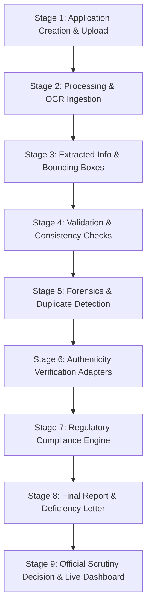

# AICTE Document Verification System — Architecture & Design Specification

## 1. System Overview

The **AICTE Document Verification System** is an AI-powered, decision-support platform designed to assist All India Council for Technical Education (AICTE) scrutiny committees and regional officers in verifying regulatory approval documents submitted by technical education institutions.

### Core Philosophy
> **"The AI recommends; the authorised official decides."**  
> Under council guidelines, automated models never declare a document definitively fraudulent, nor do they automatically issue binding approval or rejection. Every flag, forensic anomaly, and regulatory deficit is presented as an explainable, traceable finding subject to human scrutiny.

---

## 2. Nine-Stage Verification Workflow

1. **Stage 1 (Application Upload):** Three-step upload stepper, declared particulars form, magic-byte inspection (PDF, JPG, PNG), checklist requirements validator, and submission blocker.
2. **Stage 2 (Pipeline Processing):** Asynchronous polling orchestrator transitioning through Queued &rarr; Extracting Text &rarr; Classifying Type &rarr; Normalizing Fields &rarr; Completed.
3. **Stage 3 (Extracted Information):** Side-by-side visual document preview with bounding-box highlights, OCR confidence indicators, and inline official field corrections with audit tracking.
4. **Stage 4 (Document Validation):** Missing document detection, expiry validation with injectable reference date, page count validation, and cross-document/declared consistency comparison (RapidFuzz fuzzy string matching, land area and built-up area numeric tolerance checks).
5. **Stage 5 (Forensics & Duplicate Detection):** Exact SHA-256 collision detection, perceptual pHash distance calculation, template-awareness heuristics (differentiating shared affidavit forms from unique deponents), Error Level Analysis (ELA) heatmap generation, and ORB keypoint copy-move cluster detection.
6. **Stage 6 (Authenticity Verification):** Pluggable mock adapters for Municipal Town Planning, State Fire Services, Charity Commissioner, and Pollution Control Board. Mandatory `SIMULATED` badge and neutral `pending` state when gateways are unreachable or reference numbers are missing.
7. **Stage 7 (Regulatory Compliance):** Deterministic evaluation of versioned database rules against Approval Process Handbook (APH) clauses. Supports `min_value`, `ratio_max`, `boolean_present`, and `enum_match`. Features `Unverified placeholder threshold` chips for draft rules.
8. **Stage 8 (Final Report & Letters):** ReportLab PDF Dossier generation, automated 15-day statutory cure notice deficiency letter generation with official editing and copy-to-clipboard actions, and an explainable Review-Priority Score capped at 100.
9. **Stage 9 (Official Decision & Live Dashboard):** Authorised scrutiny determination bar with mandatory substantive remarks (minimum 5 characters), append-only immutable audit trail, and live council-wide Recharts aggregate dashboard.

---

## 3. Technology Stack

- **Backend:** Python 3.13, FastAPI, SQLAlchemy 2.0 ORM, Pydantic v2.
- **Database:** SQLite (local development with `StaticPool` for concurrency) designed with a clean migration path to PostgreSQL.
- **Frontend:** Next.js 14 (App Router), TypeScript, Tailwind CSS, Lucide icons, Recharts.
- **PDF & Document Processing:** PyMuPDF (fitz) with PyTesseract graceful fallback.
- **Computer Vision & Forensics:** OpenCV (`cv2`), Pillow (`PIL`), ImageHash, RapidFuzz.
- **PDF Dossier Generation:** ReportLab 5.1.
- **Authentication & Security:** JWT (JSON Web Tokens) with PBKDF2-SHA256 password hashing.

---

## 4. Role-Based Access Control (RBAC) Matrix

| Endpoint Group | Institution | Official | Admin | Auditor |
|---|---|---|---|---|
| Applications CRUD | Own only | Council-wide | Council-wide | Council-wide |
| Document Upload | Own only | No | No | No |
| Document Viewer & Bboxes | Own only | Yes | Yes | Yes |
| Field Inline Corrections | No | Yes | Yes | No |
| Flag Dismissal | No | Yes | Yes | No |
| Authenticity Verification | Yes (Read) | Yes (Trigger) | Yes (Trigger) | Yes (Read) |
| Compliance Rules View | Yes | Yes | Yes | Yes |
| Compliance Rule Versioning | No | No | Yes (Non-mutating) | No |
| Final Official Decisions | No | Yes (Mandatory Remarks) | Yes | No |
| PDF Dossier Download | Own only | Yes | Yes | Yes |
| Audit Trail Explorer | No | Yes | Yes | Yes |

---

## 5. Append-Only Audit Trail Architecture

The system enforces an append-only invariant:
- All statutory decisions, document uploads, verifications, field edits, and rule updates write to the `audit_log` table.
- There are **zero** update or delete endpoints or code paths for audit records.
- Logs capture: `actor_id`, `actor_role`, `action`, `entity_type`, `entity_id`, `before_state` (JSON), `after_state` (JSON), and UTC `timestamp`.
